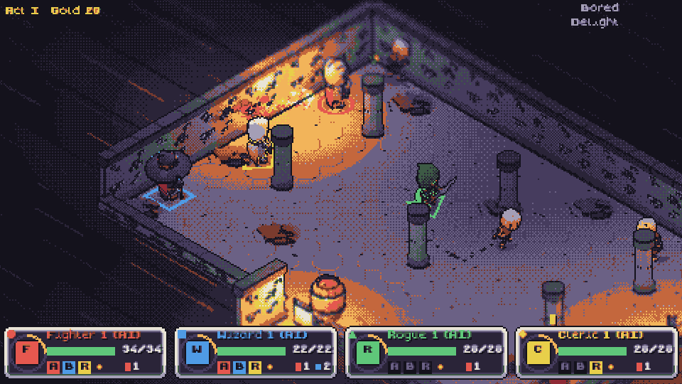
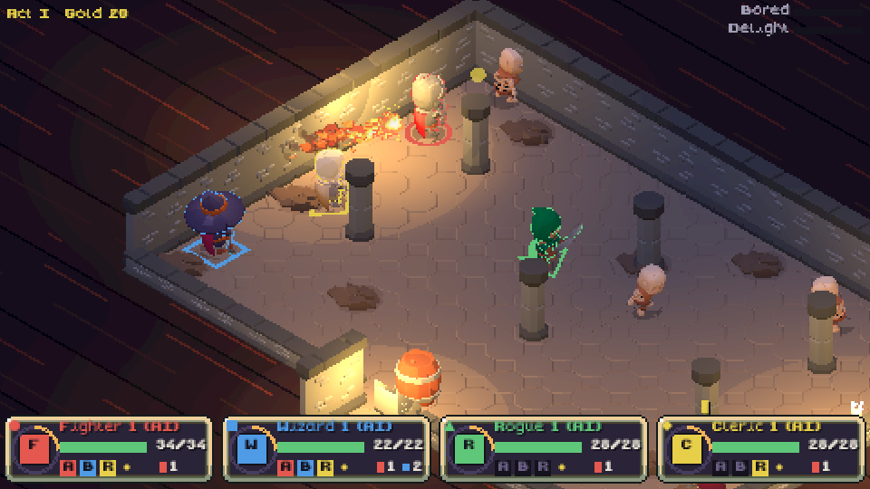
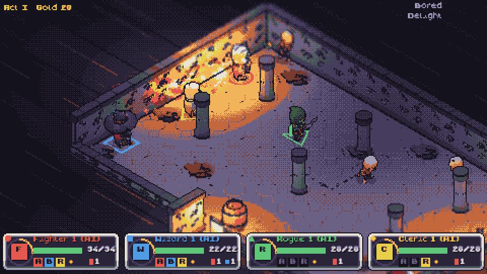

# Roll for Ruin

A tabletop-fantasy action roguelite for 1–4 local co-op players. Your party crawls a dungeon
diorama that the DM builds on a candlelit table: real-time fights run on d20 rules (SRD 5.2),
every hero has a 6-second Round Clock, and bosses freeze the table for an Initiative Break.

No game engine: TypeScript + Vite, three.js as a renderer only, Electron for the desktop app.



| Effects off (raw scene) | Mid-Fireball |
|---|---|
|  |  |

## Setup

Requirements: Node 22, git, and (Linux) the usual Electron runtime libraries.

```bash
npm ci                # exact, pinned versions from the committed lockfile
npm run assets        # fetch the CC0/MIT asset packs at pinned commits, build models, export VFX
npm run dev           # Vite dev server: open http://localhost:5173 in a browser
npm start             # build and run the desktop app (launcher first)
```

`npm run assets` is three steps you can run separately:

| Script | What it does |
|---|---|
| `npm run fetch-assets` | `git fetch --depth 1` of each pack at a pinned commit into `.cache/asset-src/` |
| `npm run build-assets` | glTF-Transform (drop unused animations, dedup, prune, resample), recolor kitbashes, copy UI/music, write `public/assets/manifest.json` |
| `npm run export-vfx` | pixelfx's own exporter (`tools/render.mjs <id> --sheet`), repacked to ≤40 frames per sheet |

The game still starts without assets (models fall back to procedural kitbashes), but it looks much
better with them.

### Checks

```bash
npm run lint          # ESLint + TypeScript (game and Electron)
npm test              # Vitest with coverage; src/rules must stay at 100%
npm run test:e2e      # Playwright _electron (needs `npm run build`; use xvfb-run on Linux)
npm run balance       # 1,000 seeded headless runs per party size → docs/BALANCE.md
```

## Controls

Everyone joins in the tavern (or at any campfire during a run): **A / Start** on a controller,
**Enter** (left keyboard player) or **Right Shift** (right keyboard player). Browsers only reveal
a controller after its first button press. Up to 4 players, any mix of controllers and keyboards.

| | Controller (Xbox / PlayStation / Switch) | Keyboard, left | Keyboard, right |
|---|---|---|---|
| Move | Left stick | W A S D | Arrow keys |
| Attack (free) | A / ✕ / B | F | Numpad 1 |
| Dodge (free, i-frames) | B / ○ / A | R | Numpad 0 |
| Action (hold: alternate) | X / □ / Y | G | Numpad 2 |
| Bonus Action (hold: alternate) | Y / △ / X | H | Numpad 3 |
| Reaction (during a telegraph) | RB / R1 / R | T | Numpad 4 |
| Interact (hold: stabilize ally) | LB / L1 / L | E | Numpad 5 |
| Help (advantage) | LT / L2 / ZL | Q | Numpad 6 |
| Companion orders (solo party) | D-pad ↑ Follow, → Focus, ↓ Hold, ← Defensive | | |
| Roll log | View / Create / − | Tab | Tab |
| Pause | Menu / Options / + | Esc | Esc |

All keys and pad buttons are rebindable in `settings.json` (`input.keysA`, `input.keysB`, `input.pad`).

**Classes** (start with 4; Barbarian, Ranger, Bard, Paladin, Warlock and Druid unlock with Renown):

| Class | Action | Bonus | Reaction | Extra |
|---|---|---|---|---|
| Fighter | Action Surge | Second Wind | Parry | Every 3rd hit shoves |
| Wizard | Fireball (slot) / hold: Grease | Misty Step | Shield | Arcane Recovery at campfires |
| Rogue | Sneak Attack strike | Dash / hold: Hide | Uncanny Dodge | |
| Cleric | Turn Undead | Healing Word / hold: Spiritual Weapon | Sanctuary | |

Reactions only work while an enemy is telegraphing (a red/gold marker on the ground and a "!").

## Debug keys

| Key | Effect |
|---|---|
| F1 | Toggle the ink outline pass |
| F2 | Toggle tilt-shift |
| F3 | Toggle the UI composite |
| F4 | Toggle palette quantize |
| F5 | Toggle Bayer dithering |
| F9 | Stats: FPS, frame time, draw calls, lights in use (always 8 in the pool), seed |
| F12 | Screenshot (saved under the user data folder, `screenshots/`) |

Useful URL / command-line switches (dev server query or `electron . --x=y`):
`--look=on|off|fireball|act2|act3|finale|finale-boss` (look test rooms),
`--demo=4 --seed=5 --speed=6` (AI party autoplays with the full UI), `--launcher`, `--skip-launcher`,
`--steam`. Hold **Shift** while the game starts to reopen the launcher.

## Launcher

Play · Settings (display mode, monitor, render scale 2–6×, vsync, volumes, accessibility) ·
controller tester (4 pads) · Credits & Licenses · update status · Open logs · "Skip launcher".
Logs rotate in `<userData>/logs`; crashes write JSON reports to `<userData>/crashes` (plus Electron
minidumps). Settings and saves are versioned JSON in the user data folder
(`%APPDATA%/Roll for Ruin`, `~/Library/Application Support/Roll for Ruin`, `~/.config/Roll for Ruin`).

## Accessibility

Hold or toggle for held actions · alternative player-identity colours (identity is always colour
**and** shape: P1 red circle, P2 blue square, P3 green triangle, P4 yellow diamond — on the ground
ring, the outline rim and the dice) · combat speed 70–100% · large text · no screen shake ·
dithering on/off · controller glyphs for Xbox, PlayStation and Switch (auto-detected or forced).

## Steam (optional)

Steamworks is behind a flag: `--steam`, `RFR_STEAM=1`, or Settings → Steam features.
`RFR_STEAM_APP_ID` sets the app id (defaults to 480, Valve's test app). Achievement ids the game
unlocks: `grease_fire`, `act_1`, `act_2`, `act_3`, `victory`. Remote Play Together needs nothing
extra: Steam streams the window and remote players' controllers arrive as local gamepads.

## Cutting a release

1. Bump `version` in `package.json` and commit.
2. Tag and push: `git tag v0.2.0 && git push origin v0.2.0`.
3. CI builds on Windows, macOS and Linux (lint → Vitest → Playwright → electron-builder) and, for a
   `v*` tag, publishes a GitHub Release with every installer plus the `latest*.yml` files that
   electron-updater reads.

Artifacts: Windows NSIS installer + portable `.exe`, macOS universal `.dmg` (+ `.zip` for
updates), Linux AppImage, `.deb` and `.tar.gz`. Only the NSIS install, the macOS app and the
AppImage self-update.

### Signing

Builds are signed and notarized only if the secrets exist:

| Secret | Used for |
|---|---|
| `CSC_LINK`, `CSC_KEY_PASSWORD` | macOS Developer ID certificate (base64 .p12) |
| `APPLE_ID`, `APPLE_APP_SPECIFIC_PASSWORD`, `APPLE_TEAM_ID` | macOS notarization |
| `WIN_CSC_LINK`, `WIN_CSC_KEY_PASSWORD` | Windows code-signing certificate |

### Opening unsigned builds

- **Windows**: SmartScreen shows "Windows protected your PC" → **More info** → **Run anyway**.
- **macOS**: right-click the app → **Open** → **Open**. If macOS says the app "is damaged", run
  `xattr -dr com.apple.quarantine "/Applications/Roll for Ruin.app"` once.
- **Linux**: `chmod +x RollForRuin-*.AppImage` then run it; or `sudo apt install ./RollForRuin-*.deb`.

## Project layout

```
electron/        main process (windows, IPC, logs, crash reports, updater, Steam) and sandboxed preload
src/shared/      settings schema + migrations, typed IPC API
src/rules/       pure dice math (100% unit-tested)
src/sim/         deterministic 60 Hz simulation: no three.js, no DOM (ESLint-enforced)
src/data/        JSON balance/content + zod schemas
src/render/      three.js renderer: post chain, camera snapping, light pool, VFX, map, kitbashes
src/input/       keyboard + Gamepad API → per-tick input frames
src/audio/       Web Audio buses, ducking, synthesized SFX
src/ui/          480×270 UI canvas: HUD, menus
src/game/        game loop, screens, saves
src/launcher/    launcher window
scripts/         asset fetch/build/VFX export, balance simulator, icon
docs/            PLAN.md, NOTES.md, BALANCE.md, screenshots
```

Credits and licenses: [CREDITS.md](CREDITS.md) and `LICENSES/`. Rules content from SRD 5.2 under
CC BY 4.0. Roll for Ruin is not affiliated with any tabletop RPG publisher.
